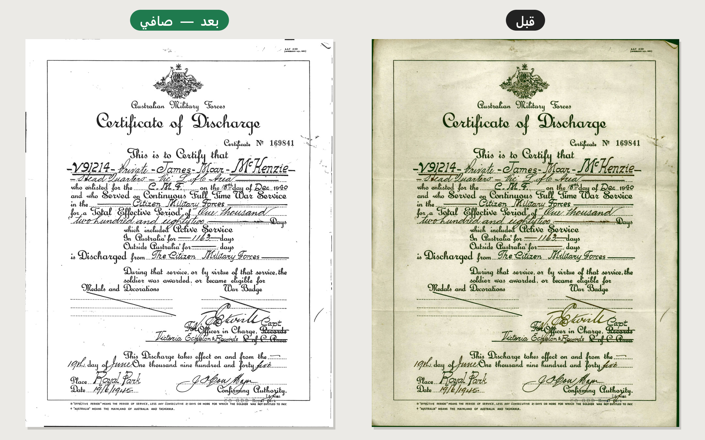
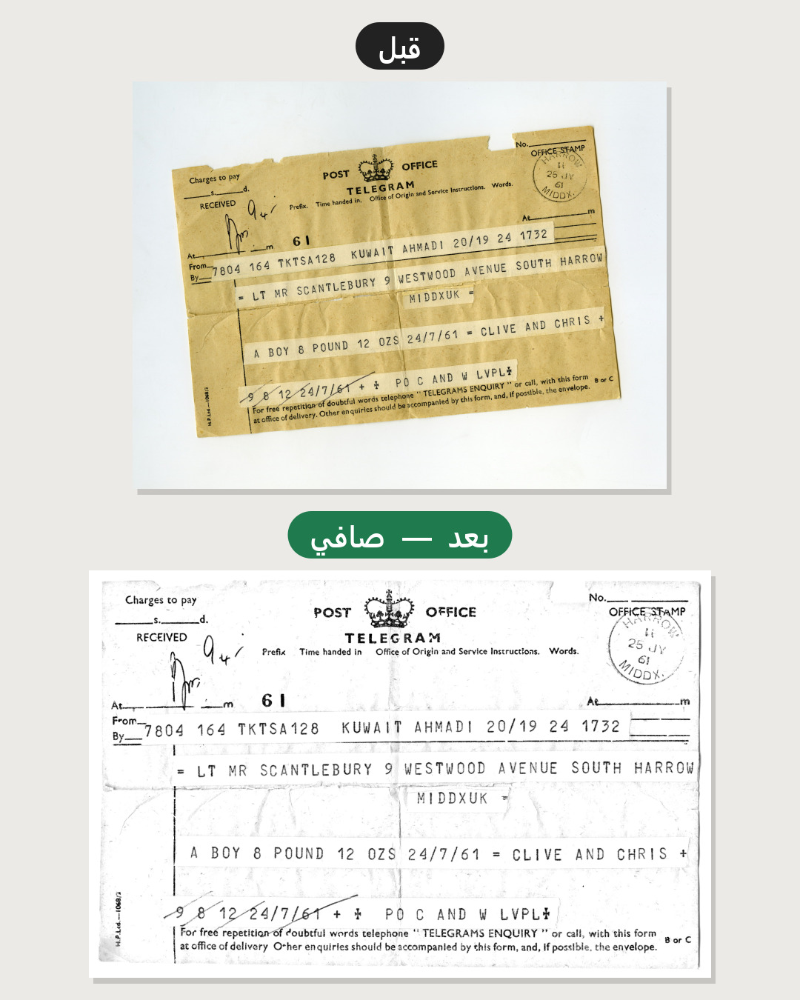
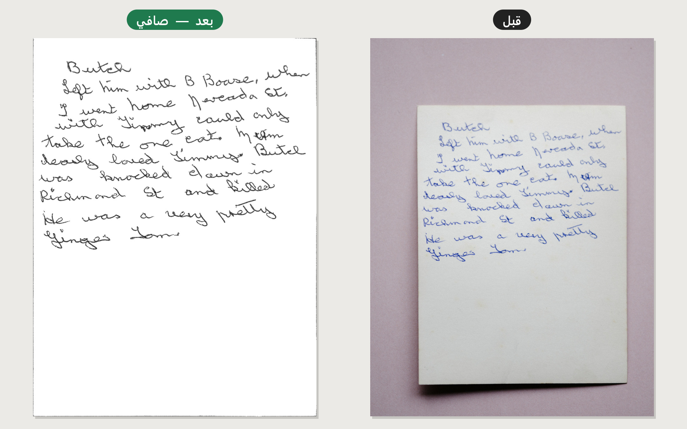

# صافي — سكانر مستندات مجاني للكمبيوتر

**صافي** برنامج ويندوز مجاني بيحوّل صور الورق اللي بتصوّرها بالموبايل لصفحات نضيفة كأنها طالعة من سكانر، وجاهزة للطباعة أو الحفظ PDF.
بديل لتطبيقات زي CamScanner بس على الكمبيوتر، **من غير اشتراك ولا علامة مائية ولا إعلانات ولا إنترنت**.

## ⬇️ التحميل

**[تحميل أحدث إصدار (Safi-Setup.exe)](../../releases/latest)**

ملف واحد بتسطّبه وخلاص. شغال على ويندوز 10 و11 (64 بت).

> لو ويندوز طلّعلك رسالة **"Windows protected your PC"** وانت بتسطّب، دوس **More info** وبعدين **Run anyway**.
> ده بيحصل مع أي برنامج جديد مش متسجّل عند مايكروسوفت.

## بيعمل إيه

- **بيقص الورقة** من الصورة ويشيل المكتب أو الترابيزة اللي وراها، وبيعدّلها لو متصوّرة مايلة.
- **بيلفّ الصفحة** لوحده لو متصوّرة بالعرض أو بالمقلوب.
- **بيشيل الظل ولون الورق**، حتى لو فيه شمس داخلة على جزء من الورقة.
- **بيحافظ على الكتابة**: الكتابة بخط اليد والأختام والتوقيعات والرقم الدفتري.
- **بيوفّر حبر الطابعة**: الجداول الغامقة والخلفيات بتتحوّل لخطوط بس.
- **يحفظ PDF** بكل الصفحات في ملف واحد، وتقدر ترتّبها قبل الحفظ وتكتب عليها نص. أو يطبع على طول، أو يحفظ صور.
- **من الموبايل للكمبيوتر**: زرار بيطلّع كود QR، تمسحه بالموبايل وتصوّر، والصور توصل الكمبيوتر على نفس الواي فاي.
- **فتح بصافي**: كليك يمين على الصور ← فتح بصافي.

## قبل وبعد

## الخصوصية

البرنامج شغال **من غير إنترنت** بالكامل. مفيش حساب، ومفيش أي حاجة بتتبعت برّه جهازك.
ميزة الموبايل بتشتغل على شبكة الواي فاي المحلية بس.

## مشكلة أو اقتراح؟

افتح **[Issue جديد](../../issues/new)** واكتب المشكلة، ولو تقدر ابعت صورة من الورقة (من غير بيانات شخصية).

البرنامج مجاني تماماً ومفيهوش أي حاجة مدفوعة.

---

# Safi — free document scanner for Windows

**Safi** turns phone photos of paper into clean, scanner-like pages, ready to print or save as PDF.
A desktop alternative to apps like CamScanner: **no subscription, no watermark, no ads, works offline**.

## ⬇️ Download

**[Download the latest release (Safi-Setup.exe)](../../releases/latest)**

A single installer. Windows 10 / 11 (64-bit).

> If Windows shows **"Windows protected your PC"**, click **More info → Run anyway**.
> This happens with any new app that is not yet signed with a commercial certificate.

## Features

- **Auto crop & perspective fix**: finds the sheet, removes the desk behind it, straightens skewed shots.
- **Auto rotation** for sideways or upside-down photos.
- **Removes shadows and paper tint**, including hard sunlight shadows across the page.
- **Keeps what matters**: handwriting, stamps, signatures and serial numbers.
- **Saves printer ink**: dark table fills and backgrounds become clean lines.
- **PDF export**: all pages in one file. Reorder pages and add text before saving. Or print directly, or export images.
- **Phone to PC**: scan a QR code and shoot with your phone; photos arrive over local Wi-Fi.
- **Open with Safi** from the Explorer right-click menu.
- Arabic (right-to-left) interface.

## Privacy

Fully **offline**. No account, no telemetry, nothing leaves your computer.
Phone transfer uses your local Wi-Fi network only.

## Feedback

Found a problem or have an idea? Open an **[issue](../../issues/new)**.

Safi is free to use. Third-party components and their licenses are listed in [NOTICES.md](NOTICES.md).
Sample "before" photos: [Unsplash](https://unsplash.com) (Unsplash License).
